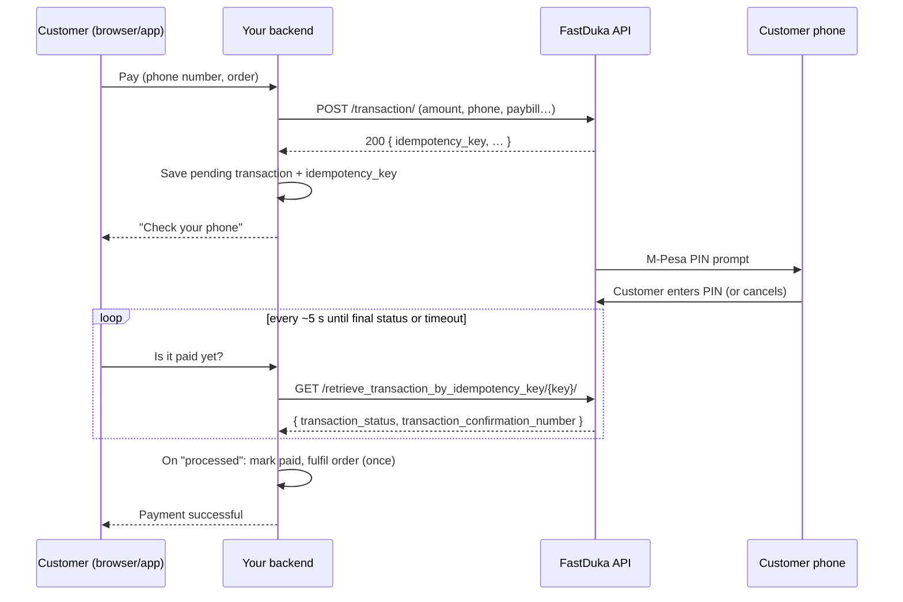

# FastDuka M-Pesa STK Push Integration Guide

A step-by-step guide to collecting M-Pesa payments through **FastDuka STK Push** from any backend, in any language.

> **Scope.** This guide covers the two FastDuka calls you need: start an STK push, then check its status. Features not covered here, such as webhooks/callbacks, sandbox environments and rate limits, should be confirmed with FastDuka before you rely on them.

---

## Contents

- [FastDuka M-Pesa STK Push Integration Guide](#fastduka-m-pesa-stk-push-integration-guide)
  - [Contents](#contents)
  - [1. How it works](#1-how-it-works)
  - [2. Prerequisites and credentials](#2-prerequisites-and-credentials)
  - [3. Authentication](#3-authentication)
  - [4. Step 1: Initiate an STK push](#4-step-1-initiate-an-stk-push)
    - [Request body](#request-body)
    - [Response](#response)
    - [Phone number format](#phone-number-format)
    - [Currency](#currency)
  - [5. Step 2: Check the transaction status](#5-step-2-check-the-transaction-status)
    - [Response fields](#response-fields)
    - [Status values](#status-values)
  - [6. Polling strategy](#6-polling-strategy)
  - [7. Fulfilling the payment safely](#7-fulfilling-the-payment-safely)
  - [8. Code examples](#8-code-examples)
    - [curl](#curl)
    - [Python (`requests`)](#python-requests)
    - [Node.js / TypeScript (`fetch`, Node 18+)](#nodejs--typescript-fetch-node-18)
    - [Wiring it into your app](#wiring-it-into-your-app)
  - [9. Error handling and troubleshooting](#9-error-handling-and-troubleshooting)
  - [10. Production checklist](#10-production-checklist)

---

## 1. How it works

In an STK push ("SIM Toolkit push"), the M-Pesa PIN prompt is sent straight to the customer's phone. The customer enters their PIN on the phone and never types a paybill or account number.

The flow is **asynchronous**. When you start the push you get a reference (`idempotency_key`) back right away, but the payment completes only after the customer acts on their phone. That usually takes 5–60 seconds, and sometimes the customer never acts.



**Golden rule:** your **backend** must be the only thing that talks to FastDuka. Never put the API key in a browser or mobile app.

---

## 2. Prerequisites and credentials

From FastDuka you need:

| Credential | What it is | Suggested env var |
|---|---|---|
| API key | Secret key used to authenticate API calls | `FASTDUKA_API_KEY` |
| Paybill / till number | The M-Pesa account that receives the money | `FASTDUKA_PAYBILL` |
| Organization ID | Your organization's ID on FastDuka | `FASTDUKA_ORGID` |
| Config ID | The payment configuration to use for the transaction | `FASTDUKA_CONFIG_ID` |

Example `.env`:

```dotenv
FASTDUKA_API_KEY="your-secret-api-key"
FASTDUKA_PAYBILL="1234567"
FASTDUKA_ORGID="your-org-id"
FASTDUKA_CONFIG_ID="your-config-id"
```

Keep these out of version control and load them from the environment at runtime.

---

## 3. Authentication

| | |
|---|---|
| **Base URL** | `https://api.fastduka.co.ke/api` |
| **Auth header** | `Authorization: Api-Key <FASTDUKA_API_KEY>` |
| **Content type** | `Content-Type: application/json` |

Note that the scheme is literally `Api-Key` (not `Bearer`), followed by a space and your key.

---

## 4. Step 1: Initiate an STK push

```
POST https://api.fastduka.co.ke/api/transaction/
```

### Request body

| Field | Type | Required | Description |
|---|---|---|---|
| `customer_account_number` | string | yes | Customer's M-Pesa phone number in international format, e.g. `+254712345678` |
| `amount` | string | yes | Amount in **KES**, sent as a string, e.g. `"1500.00"` |
| `receiving_account_number` | string | yes | Your paybill / till number (`FASTDUKA_PAYBILL`) |
| `receiving_organization_id` | string | yes | Your FastDuka organization ID (`FASTDUKA_ORGID`) |
| `payment_method_name` | string | yes | Always `"mpesa"` |
| `payment_method_subtype` | string | yes | Always `"stk_push"` |
| `config_id` | string | yes | Your FastDuka config ID (`FASTDUKA_CONFIG_ID`) |
| `transaction_note` | string | recommended | Human-readable reference, e.g. `"Order #1042"`. Useful for reconciliation |

Example:

```json
{
  "customer_account_number": "+254712345678",
  "amount": "1500.00",
  "receiving_account_number": "1234567",
  "receiving_organization_id": "your-org-id",
  "payment_method_name": "mpesa",
  "payment_method_subtype": "stk_push",
  "config_id": "your-config-id",
  "transaction_note": "Order #1042"
}
```

### Response

A successful call returns HTTP **200**. The one field you must keep is:

| Field | Description |
|---|---|
| `idempotency_key` | Unique reference for this transaction. **Save it**, because it is the only way to check the status later. |

Treat any other status code as a failure to start the push, and show the customer a retry option.

### Phone number format

Normalise numbers on your backend before sending them. All of these should become `+254712345678`:

| Input | Normalised |
|---|---|
| `0712345678` | `+254712345678` |
| `712345678` | `+254712345678` |
| `254712345678` | `+254712345678` |
| `+254712345678` | `+254712345678` |

### Currency

M-Pesa works in **KES**. If you price in USD or another currency, convert to KES **before** calling FastDuka, and store the KES amount you actually charged.

---

## 5. Step 2: Check the transaction status

```
GET https://api.fastduka.co.ke/api/retrieve_transaction_by_idempotency_key/{idempotency_key}/
```

Use the same auth headers. The trailing slash is part of the path.

### Response fields

| Field | Description |
|---|---|
| `transaction_status` | Current state of the transaction (see the table below) |
| `transaction_confirmation_number` | The M-Pesa receipt code (e.g. `SJK3XXXXXX`) once the payment succeeds; empty before that |

### Status values

| `transaction_status` | Meaning | What to do |
|---|---|---|
| `processed` | Customer paid successfully | Mark as **paid** and fulfil the order |
| `failed` | Payment failed (e.g. insufficient funds, wrong PIN) | Mark as **failed** and offer a retry |
| `cancelled` | Customer dismissed the prompt | Mark as **failed** and offer a retry |
| anything else | Still in progress | Keep it **pending** and poll again |

Map unknown values to "pending" rather than "failed", so a new intermediate status from FastDuka doesn't make you reject real payments.

---

## 6. Polling strategy

Recommended pattern:

1. **Wait ~5 seconds** after initiating, because the customer needs time to see the prompt.
2. **Poll every ~5 seconds.**
3. **Stop** when the status is `processed`, `failed` or `cancelled`.
4. **Time out after ~2 minutes.** Show "We couldn't confirm your payment yet" and leave the transaction pending, so a background job can reconcile it later (see [§10](#10-production-checklist)).

Your client (browser/app) should poll **your own backend**. Your backend then calls FastDuka. This keeps the API key server-side and lets you apply fulfilment logic in one place.

---

## 7. Fulfilling the payment safely

Polling means your status-check code can run many times for the same transaction, sometimes concurrently. Protect against double fulfilment:

- **Store a local transaction record** when you initiate it: your order/invoice ID, the KES amount, `idempotency_key`, and status `pending`.
- **Use a "fulfilled" flag** (or a unique constraint) on that record. Only fulfil the order (mark the invoice paid, provision the service, send the receipt email) if the flag is not set yet, and set it in the same database transaction.
- **Store the raw FastDuka response** (e.g. as JSON) for audits and disputes.
- **Store `transaction_confirmation_number`** as the M-Pesa receipt. Customers will quote it when they contact support.
- **Check the amount.** Make sure the amount you recorded matches what you expected to collect before fulfilling.

---

## 8. Code examples

### curl

```bash
# 1. Initiate
curl -X POST "https://api.fastduka.co.ke/api/transaction/" \
  -H "Authorization: Api-Key $FASTDUKA_API_KEY" \
  -H "Content-Type: application/json" \
  -d '{
    "customer_account_number": "+254712345678",
    "amount": "10",
    "receiving_account_number": "'"$FASTDUKA_PAYBILL"'",
    "receiving_organization_id": "'"$FASTDUKA_ORGID"'",
    "payment_method_name": "mpesa",
    "payment_method_subtype": "stk_push",
    "config_id": "'"$FASTDUKA_CONFIG_ID"'",
    "transaction_note": "Test payment"
  }'

# 2. Check status (use the idempotency_key from step 1)
curl "https://api.fastduka.co.ke/api/retrieve_transaction_by_idempotency_key/<IDEMPOTENCY_KEY>/" \
  -H "Authorization: Api-Key $FASTDUKA_API_KEY"
```

### Python (`requests`)

```python
import os
import re
import time
from decimal import Decimal

import requests

FASTDUKA_API_BASE = "https://api.fastduka.co.ke/api"

STATUS_MAP = {
    "processed": "succeeded",
    "failed": "failed",
    "cancelled": "failed",
}


class FastDukaError(Exception):
    pass


def _headers() -> dict:
    return {
        "Authorization": f"Api-Key {os.environ['FASTDUKA_API_KEY']}",
        "Content-Type": "application/json",
    }


def normalise_kenyan_phone(phone: str) -> str:
    digits = re.sub(r"\D", "", phone)
    if digits.startswith("254"):
        digits = digits[3:]
    digits = digits.lstrip("0")
    if len(digits) != 9:
        raise ValueError(f"Invalid Kenyan phone number: {phone}")
    return f"+254{digits}"


def initiate_stk_push(phone: str, amount_kes: Decimal, note: str) -> str:
    """Send an STK push. Returns the idempotency_key to poll with."""
    payload = {
        "customer_account_number": normalise_kenyan_phone(phone),
        "amount": str(amount_kes),
        "receiving_account_number": os.environ["FASTDUKA_PAYBILL"],
        "receiving_organization_id": os.environ["FASTDUKA_ORGID"],
        "payment_method_name": "mpesa",
        "payment_method_subtype": "stk_push",
        "config_id": os.environ["FASTDUKA_CONFIG_ID"],
        "transaction_note": note,
    }
    response = requests.post(
        f"{FASTDUKA_API_BASE}/transaction/", json=payload, headers=_headers(), timeout=30
    )
    if response.status_code != 200:
        raise FastDukaError(f"STK push failed ({response.status_code}): {response.text}")
    return response.json()["idempotency_key"]


def get_transaction(idempotency_key: str) -> dict:
    """Fetch the current state of a transaction."""
    response = requests.get(
        f"{FASTDUKA_API_BASE}/retrieve_transaction_by_idempotency_key/{idempotency_key}/",
        headers=_headers(),
        timeout=30,
    )
    if response.status_code != 200:
        raise FastDukaError(f"Status check failed ({response.status_code}): {response.text}")
    data = response.json()
    return {
        "status": STATUS_MAP.get(data.get("transaction_status", ""), "pending"),
        "receipt": data.get("transaction_confirmation_number") or None,
        "raw": data,
    }


def wait_for_payment(idempotency_key: str, timeout_s: int = 120, interval_s: int = 5) -> dict:
    """Blocking poll helper, for scripts and background jobs (not request handlers)."""
    time.sleep(interval_s)
    deadline = time.monotonic() + timeout_s
    while time.monotonic() < deadline:
        result = get_transaction(idempotency_key)
        if result["status"] != "pending":
            return result
        time.sleep(interval_s)
    return {"status": "pending", "receipt": None, "raw": None}


if __name__ == "__main__":
    key = initiate_stk_push("0712345678", Decimal("10"), "Test payment")
    print("STK push sent, idempotency_key =", key)
    print(wait_for_payment(key))
```

### Node.js / TypeScript (`fetch`, Node 18+)

```ts
const FASTDUKA_API_BASE = "https://api.fastduka.co.ke/api";

type PaymentStatus = "succeeded" | "failed" | "pending";

const STATUS_MAP: Record<string, PaymentStatus> = {
  processed: "succeeded",
  failed: "failed",
  cancelled: "failed",
};

function headers(): Record<string, string> {
  return {
    Authorization: `Api-Key ${process.env.FASTDUKA_API_KEY}`,
    "Content-Type": "application/json",
  };
}

export function normaliseKenyanPhone(phone: string): string {
  let digits = phone.replace(/\D/g, "");
  if (digits.startsWith("254")) digits = digits.slice(3);
  digits = digits.replace(/^0+/, "");
  if (digits.length !== 9) throw new Error(`Invalid Kenyan phone number: ${phone}`);
  return `+254${digits}`;
}

/** Send an STK push. Returns the idempotency_key to poll with. */
export async function initiateStkPush(phone: string, amountKes: string, note: string): Promise<string> {
  const res = await fetch(`${FASTDUKA_API_BASE}/transaction/`, {
    method: "POST",
    headers: headers(),
    body: JSON.stringify({
      customer_account_number: normaliseKenyanPhone(phone),
      amount: amountKes,
      receiving_account_number: process.env.FASTDUKA_PAYBILL,
      receiving_organization_id: process.env.FASTDUKA_ORGID,
      payment_method_name: "mpesa",
      payment_method_subtype: "stk_push",
      config_id: process.env.FASTDUKA_CONFIG_ID,
      transaction_note: note,
    }),
    signal: AbortSignal.timeout(30_000),
  });
  if (res.status !== 200) throw new Error(`STK push failed (${res.status}): ${await res.text()}`);
  const data = await res.json();
  return data.idempotency_key;
}

/** Fetch the current state of a transaction. */
export async function getTransaction(idempotencyKey: string) {
  const res = await fetch(
    `${FASTDUKA_API_BASE}/retrieve_transaction_by_idempotency_key/${idempotencyKey}/`,
    { headers: headers(), signal: AbortSignal.timeout(30_000) },
  );
  if (res.status !== 200) throw new Error(`Status check failed (${res.status}): ${await res.text()}`);
  const data = await res.json();
  return {
    status: STATUS_MAP[data.transaction_status] ?? ("pending" as PaymentStatus),
    receipt: (data.transaction_confirmation_number as string) || null,
    raw: data,
  };
}
```

### Wiring it into your app

Expose two endpoints on **your** backend. Paths and names are up to you:

| Your endpoint | Does |
|---|---|
| `POST /payments/mpesa/initiate` `{ orderId, phone }` | Validates the order belongs to the user, converts the amount to KES, calls `initiate_stk_push`, saves a pending transaction with the `idempotency_key`, and returns your transaction ID |
| `POST /payments/mpesa/confirm` `{ transactionId }` | Loads your transaction, calls `get_transaction`, updates the status/receipt/raw JSON, fulfils **once** on success, and returns the status |

The frontend calls `initiate`, shows "Check your phone", then calls `confirm` every 5 seconds until the status is `succeeded` or `failed`, or the timeout is reached.

---

## 9. Error handling and troubleshooting

| Symptom | Likely cause | Fix |
|---|---|---|
| `401` / `403` on any call | Wrong or missing API key, or wrong header scheme | Use `Authorization: Api-Key <key>` exactly |
| Non-200 on `/transaction/` with a validation message | Missing `config_id`, `receiving_organization_id` or paybill, or a bad amount | Check that all env vars are set and that `amount` is a positive KES value |
| Customer gets no prompt | Wrong phone format, a non-Safaricom number, or the phone is off/out of coverage | Normalise to `+2547…` / `+2541…`; ask the customer to check their phone and retry |
| Status stays pending for a long time | Customer ignored the prompt | Time out after ~2 min and offer a retry; reconcile later in the background |
| Status `cancelled` | Customer dismissed the prompt | Offer a retry |
| Order fulfilled twice | Concurrent polls both saw `processed` | Use a "fulfilled" flag set atomically (see [§7](#7-fulfilling-the-payment-safely)) |
| Request hangs | No timeout set | Always pass a timeout (30 s is reasonable) |

Always log the FastDuka response body on errors. It usually says exactly what is wrong.

---

## 10. Production checklist

- [ ] API key stored as a secret, never sent to clients and never committed
- [ ] Timeouts set on every FastDuka request
- [ ] Phone numbers normalised server-side
- [ ] Amounts converted to and stored in KES
- [ ] `idempotency_key` saved with every initiated transaction
- [ ] Unknown statuses treated as pending, not failed
- [ ] Fulfilment guarded so it runs **exactly once** per transaction
- [ ] Raw FastDuka responses and M-Pesa receipt codes stored for support and audits
- [ ] Client polling has a timeout and a clear retry path
- [ ] A **scheduled job** (e.g. every 5–10 min) re-checks transactions left `pending` and fulfils or fails them, so payments completed after the user closed the page are not lost
- [ ] Ownership checks on your initiate/confirm endpoints, so users can only pay for or poll their own orders
